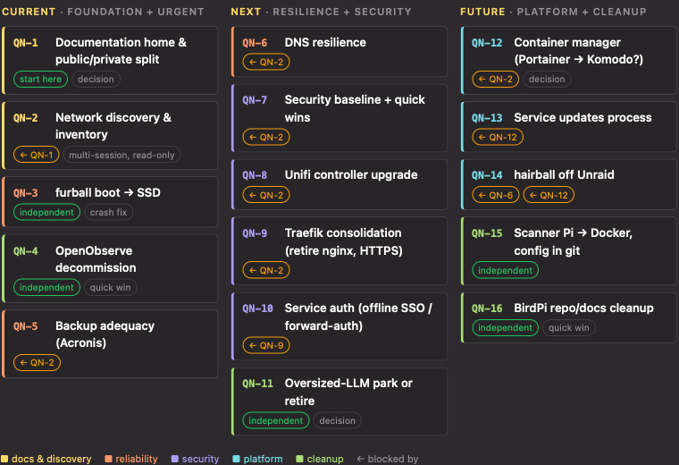

# Handoff — showing the queue as an inline visual

**Date:** 2026-11-01. A snapshot of how the session that created the QN- queue drew it inline in
chat. This is not a workflow, a proposal or a queue item; whether it becomes one is TBD. Like every
handoff, it is not maintained to reality.

## What it was

A three-column board of the queue, rendered inline in the Atrium agent-chat transcript and titled
"network-config queue: QN-1 … QN-16". It had one column per sprint (`current`, `next`, `future`)
and one card per row, in queue order. Each card showed the id, a short name and chips:

- An amber `← QN-n` chip for each blocker, taken from the row's `Blocked:` note.
- A green `independent` (or `start here`) chip for a row with no blocker.
- A grey chip for a hint such as `decision`, `quick win` or `multi-session, read-only`.

The colored left border showed a theme: docs & discovery, reliability, security, platform or
cleanup. A legend under the board explained the colors.

The theme grouping and the short names were written by hand for the picture. They are not in the
queue file. QN-17 was added after the visual was made, so it isn't shown.



The image is the `atrium html preview` PNG from the session (760 px wide, Monokai Pro dark theme),
copied from Atrium's preview cache. Inline in chat, the page follows the viewer's own theme, so the
colors differ from this capture.

## How it was made

It is an **Atrium HTML page**, Atrium's way to show a custom visual inline in an agent-chat pane.
The reference is `~/.claude/skills/atrium/references/chat-html-pages.md`, part of the `atrium` skill.
The alternative is a ` ```canvas ` fence, which suits metrics, tables, standard charts and input
forms. A page was used because a custom card layout with chips is easier to control in plain HTML.

1. **Write** one self-contained HTML file: inline CSS, no JS, no external assets.
   - Draw with Atrium's theme tokens (`var(--tile)`, `var(--hairline)`, `var(--text-muted)`,
     `var(--accent)`, `var(--chart-1)`…`var(--chart-5)`, `var(--warning)`, `var(--success)`,
     `var(--font-mono)`, `var(--radius-sm)`), so the page matches and re-themes with the user's
     theme. `atrium html tokens` lists them with current values.
   - Layout rules: a transparent page, fluid width, no `100vh`, no outer card or banner.
     `grid-template-columns: repeat(auto-fit, minmax(230px, 1fr))` gives three columns on desktop
     and stacks them on a phone.
   - ⚠️ The session wrote the file to `/tmp/network-queue/queue.html`. Since 2026-11-01 the repo
     rule is scratch in the gitignored `.tmp/<task>/`, so use `.tmp/queue-visual/queue.html`.
2. **Preview:** `"$ATRIUM_CLI_PATH" html preview <file>`. It renders the page the way Atrium shows
   it and prints the PNG path, the content height and any exceptions. **Look at the PNG** with the
   image-reading tool before publishing. `--theme light|dark` checks the other theme, and
   `--width 390` checks phone width. The run here reported `760 px wide, 521 px tall`, with no
   exceptions.
3. **Publish:** `"$ATRIUM_CLI_PATH" html publish <file> --title "network-config queue: QN-1 … QN-16"`.
   Its stdout is just the fence.
4. **Paste the fence** into the chat reply exactly as printed. ⛔ Never retype the hash. The page is
   stored by hash, and the fence only points at it. The fence from this session:

   ````
   ```html render
   {"v":1,"page":"c58446f1e1ed8761524e404a53c11599346893f3ef7a883e1452f8405f1d373f","title":"network-config queue: QN-1 … QN-16","heights":{"390":1197,"600":863,"760":521,"960":482}}
   ```
   ````

5. **Don't restate the page** in the reply's prose. Write only what the page doesn't say.

**Where it renders:** Atrium agent-chat panes, on the Mac and in the iPhone/iPad app. A terminal
pane (for example Claude Code in tmux through `ccl`) renders no markdown, so the fence shows as
text. There, an Atrium HTML note would be needed instead. Outside Atrium it doesn't render at all.

## The page source, as built

The data was typed in by hand from `docs/proposals/_implementation-order.md`: the id, sprint and
`Blocked:` note of each row. The names, hint chips and theme colors were added for the picture.

```html
<!doctype html>
<html><head><meta charset="utf-8">
<style>
  .wrap { display: grid; grid-template-columns: repeat(auto-fit, minmax(230px, 1fr)); gap: 14px; padding: 4px 2px 8px; }
  .col h3 { margin: 0 0 8px; font-size: 0.8em; letter-spacing: .08em; text-transform: uppercase; color: var(--text-muted); font-weight: 600; }
  .col h3 span { color: var(--accent); }
  .card { background: var(--tile); border: 1px solid var(--hairline); border-radius: var(--radius-sm); padding: 7px 10px; margin-bottom: 7px; border-left: 3px solid var(--c); }
  .row { display: flex; align-items: baseline; gap: 8px; }
  .id { font-family: var(--font-mono); font-size: .82em; color: var(--c); font-weight: 600; min-width: 3.4em; }
  .name { font-weight: 550; font-size: .93em; }
  .meta { margin-top: 3px; display: flex; flex-wrap: wrap; gap: 4px; }
  .chip { font-size: .72em; padding: 1px 6px; border-radius: 999px; border: 1px solid var(--border); color: var(--text-muted); }
  .chip.block { border-color: var(--warning); color: var(--warning); }
  .chip.free { border-color: var(--success); color: var(--success); }
  .legend { font-size: .78em; color: var(--text-muted); margin-top: 2px; display: flex; gap: 14px; flex-wrap: wrap; }
  .c1 { --c: var(--chart-1); } .c2 { --c: var(--chart-2); } .c3 { --c: var(--chart-3); } .c4 { --c: var(--chart-4); } .c5 { --c: var(--chart-5); }
</style></head>
<body>
<div class="wrap">
  <div class="col"><h3><span>current</span> · foundation + urgent</h3>
    <div class="card c1"><div class="row"><span class="id">QN-1</span><span class="name">Documentation home &amp; public/private split</span></div><div class="meta"><span class="chip free">start here</span><span class="chip">decision</span></div></div>
    <div class="card c1"><div class="row"><span class="id">QN-2</span><span class="name">Network discovery &amp; inventory</span></div><div class="meta"><span class="chip block">← QN-1</span><span class="chip">multi-session, read-only</span></div></div>
    <div class="card c2"><div class="row"><span class="id">QN-3</span><span class="name">furball boot → SSD</span></div><div class="meta"><span class="chip free">independent</span><span class="chip">crash fix</span></div></div>
    <div class="card c3"><div class="row"><span class="id">QN-4</span><span class="name">OpenObserve decommission</span></div><div class="meta"><span class="chip free">independent</span><span class="chip">quick win</span></div></div>
    <div class="card c2"><div class="row"><span class="id">QN-5</span><span class="name">Backup adequacy (Acronis)</span></div><div class="meta"><span class="chip block">← QN-2</span></div></div>
  </div>
  <div class="col"><h3><span>next</span> · resilience + security</h3>
    <div class="card c2"><div class="row"><span class="id">QN-6</span><span class="name">DNS resilience</span></div><div class="meta"><span class="chip block">← QN-2</span></div></div>
    <div class="card c4"><div class="row"><span class="id">QN-7</span><span class="name">Security baseline + quick wins</span></div><div class="meta"><span class="chip block">← QN-2</span></div></div>
    <div class="card c4"><div class="row"><span class="id">QN-8</span><span class="name">Unifi controller upgrade</span></div><div class="meta"><span class="chip block">← QN-2</span></div></div>
    <div class="card c4"><div class="row"><span class="id">QN-9</span><span class="name">Traefik consolidation (retire nginx, HTTPS)</span></div><div class="meta"><span class="chip block">← QN-2</span></div></div>
    <div class="card c4"><div class="row"><span class="id">QN-10</span><span class="name">Service auth (offline SSO / forward-auth)</span></div><div class="meta"><span class="chip block">← QN-9</span></div></div>
    <div class="card c3"><div class="row"><span class="id">QN-11</span><span class="name">Oversized-LLM park or retire</span></div><div class="meta"><span class="chip free">independent</span><span class="chip">decision</span></div></div>
  </div>
  <div class="col"><h3><span>future</span> · platform + cleanup</h3>
    <div class="card c5"><div class="row"><span class="id">QN-12</span><span class="name">Container manager (Portainer → Komodo?)</span></div><div class="meta"><span class="chip block">← QN-2</span><span class="chip">decision</span></div></div>
    <div class="card c5"><div class="row"><span class="id">QN-13</span><span class="name">Service updates process</span></div><div class="meta"><span class="chip block">← QN-12</span></div></div>
    <div class="card c5"><div class="row"><span class="id">QN-14</span><span class="name">hairball off Unraid</span></div><div class="meta"><span class="chip block">← QN-6</span><span class="chip block">← QN-12</span></div></div>
    <div class="card c3"><div class="row"><span class="id">QN-15</span><span class="name">Scanner Pi → Docker, config in git</span></div><div class="meta"><span class="chip free">independent</span></div></div>
    <div class="card c3"><div class="row"><span class="id">QN-16</span><span class="name">BirdPi repo/docs cleanup</span></div><div class="meta"><span class="chip free">independent</span><span class="chip">quick win</span></div></div>
  </div>
</div>
<div class="legend"><span style="color:var(--chart-1)">■ docs &amp; discovery</span><span style="color:var(--chart-2)">■ reliability</span><span style="color:var(--chart-4)">■ security</span><span style="color:var(--chart-5)">■ platform</span><span style="color:var(--chart-3)">■ cleanup</span><span>← blocked by</span></div>
</body></html>
```

## Notes for whoever picks this up

- **What can be derived:** everything except the theme colors, short names and hint chips comes
  from the queue table. That covers the id, sprint, status, order, and blockers parsed from `Blocked:`
  in Notes. A generator could build the board from `_implementation-order.md`.
  `agent-skills/lib/queue-plan.cjs` already parses that table for the machine-wide skills.
- **What can't be derived:** the theme grouping and short names have no home in the queue today.
  Adding them would mean changing the queue format, which `planning.instructions.md` governs and the
  machine-wide skills parse. Alternatives: derive the name from the proposal's `#` title, and drop
  the themes.
- **Status isn't shown.** Every row was ⬜ at the time. A reusable version would show each row's
  status (⬜ 🟡 ✅ ⛔), and maybe hide or dim ✅ and ⛔ rows.
- **Hand-made boards go stale** as soon as the queue changes. This one already lacks QN-17. Re-draw
  the board when it's requested; don't keep it as a doc.
- The same page works in `karens-database` and `readingorder.info-2025`. Their queues have the same
  columns, though `readingorder.info-2025` has extra named sprints.
